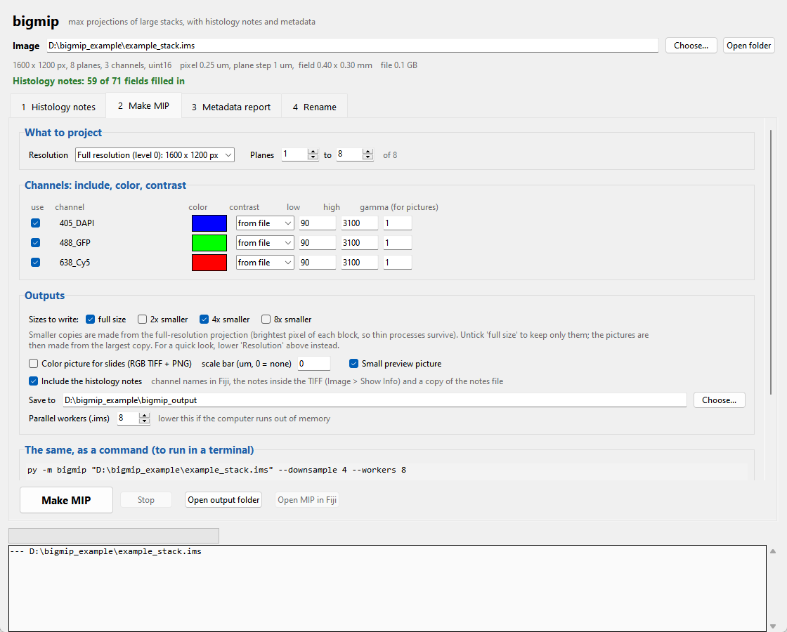
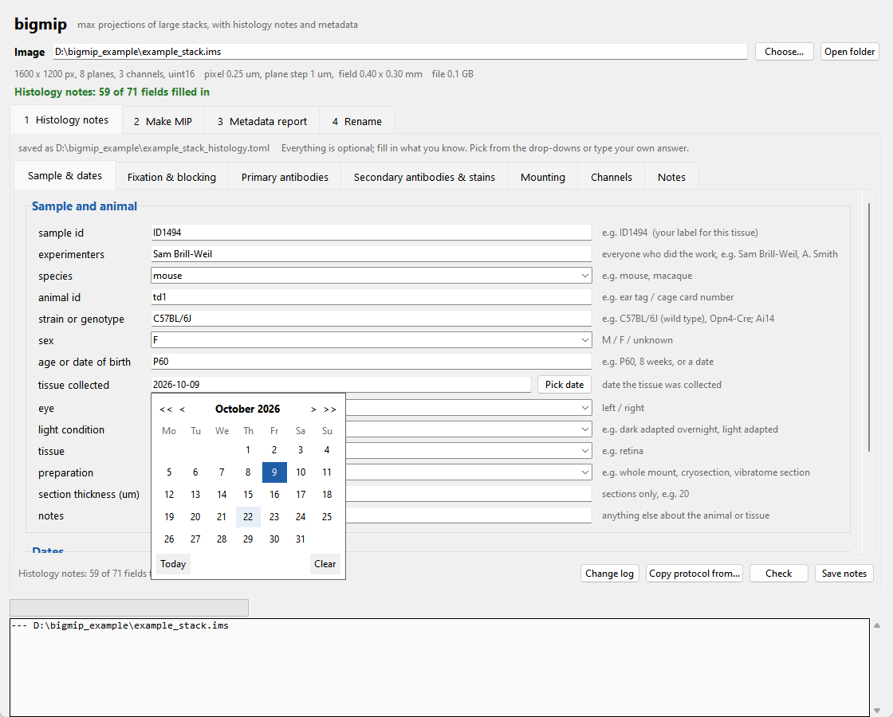
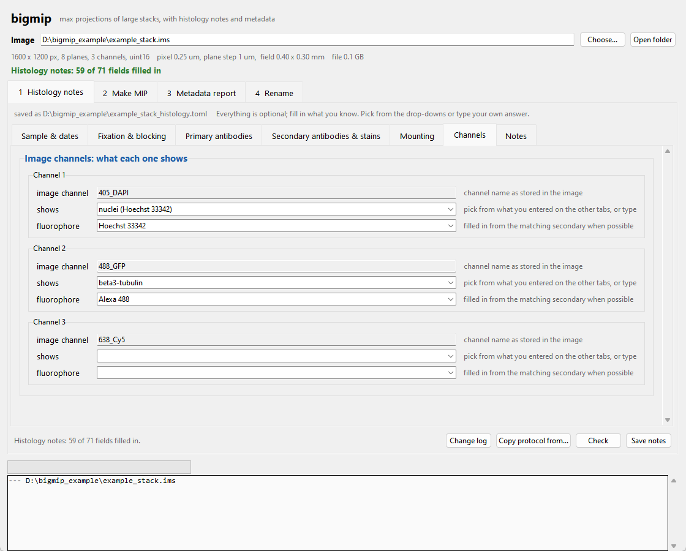
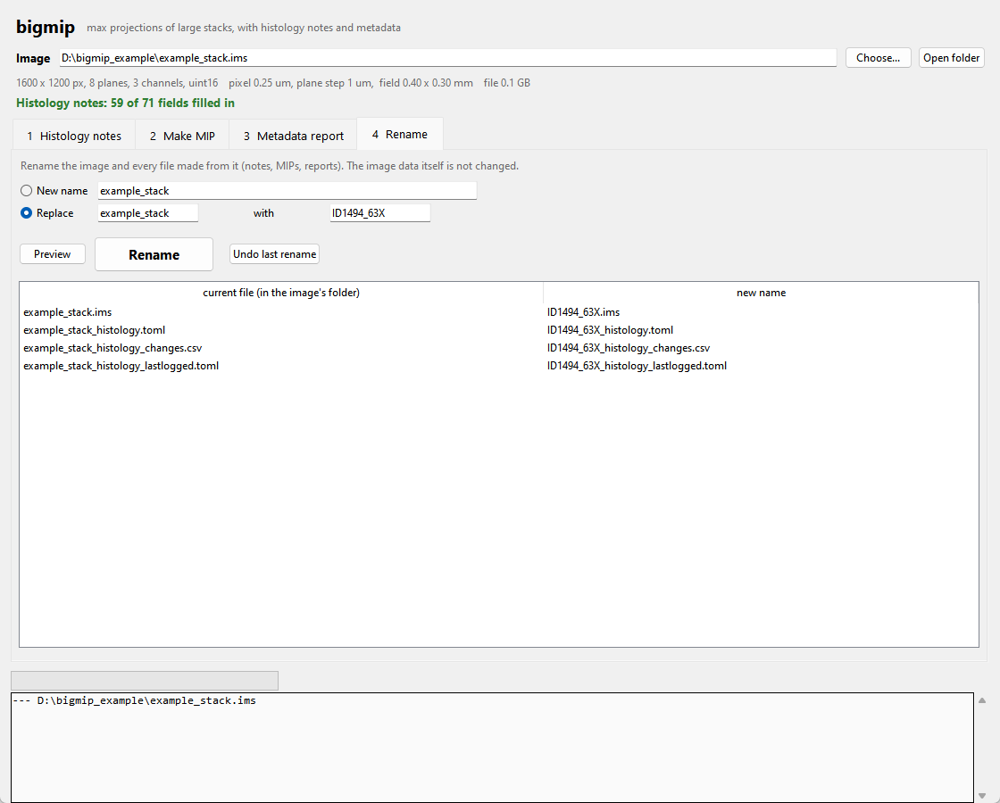

# bigmip

Turn a very large 3-D microscopy stack into a **maximum-intensity projection (MIP)** that keeps the **pixel size
(scale)**, the **channel names** and the **channel colors**. The result is a TIFF that **Fiji** opens as a colored
multi-channel image with the right scale. Your original file is only ever read, never changed.

bigmip is built for files too big to open normally: a 100–200 GB stitched spinning-disk stack is projected while only
a few blocks are held in memory at a time.

It also keeps your records together:
- **Histology notes:** a form for the staining details (animal, dates, antibodies, dilutions, incubations, washes,
  mounting, what each channel shows). Every field is optional, and the notes travel with every output.
- **Metadata report:** a readable summary of what the microscope recorded in an Imaris `.ims` file (channels,
  exposure, laser power, objective, camera, Z-step, ...).
- **Rename:** rename an image and every file made from it in one step, e.g. when the file name has the wrong
  objective in it.

Everything runs in **one window** (the bigmip app), or from the command line. It is plain Python: you need only
Python, a few free Python packages, and Fiji to look at the results.



---

## Contents
1. [One-time setup](#1-one-time-setup-install)
2. [The bigmip app](#2-the-bigmip-app)
3. [What it reads and writes](#3-what-it-reads-and-writes)
4. [Command line (optional)](#4-command-line-optional)
5. [Looking at the results in Fiji](#5-looking-at-the-results-in-fiji)
6. [Browsing the full 3-D stack in BigDataViewer](#6-browsing-the-full-3-d-stack-in-bigdataviewer)
7. [Troubleshooting](#7-troubleshooting)
8. [How it works](#8-how-it-works)

---

## 1. One-time setup (install)

You do this once per computer. It takes about 10 minutes.

### 1a. Install Python
- **Windows:** go to <https://www.python.org/downloads/>, click the yellow "Download Python 3.x" button and run the
  installer. **On the first screen, tick "Add python.exe to PATH"**, then click "Install Now".
- **Mac:** download the macOS installer from the same page, open it and click through.

bigmip needs Python 3.11 or newer; the current download is fine.

### 1b. Install Fiji
Go to <https://fiji.sc>, download Fiji for your computer and unzip it somewhere you'll find it again (e.g. your
Documents folder). There is no installer: start it by double-clicking `Fiji.app` (Mac) or `ImageJ-win64.exe` inside
the `Fiji.app` folder (Windows). Fiji already includes BigDataViewer.

### 1c. Install GitHub Desktop
bigmip is downloaded and kept up to date with **GitHub Desktop** (free): <https://desktop.github.com>.
1. You need a free GitHub account (<https://github.com/signup>). Send your GitHub username to Sam Brill-Weil to get
   access, then accept the invitation that arrives by email.
2. Install GitHub Desktop, open it and sign in with that account.

### 1d. Get bigmip
In GitHub Desktop: **File › Clone repository**. On the **GitHub.com** tab, pick **sambrillweil/bigmip** (or, on the
**URL** tab, paste `https://github.com/sambrillweil/bigmip`). Choose where to keep it (e.g.
`Documents\GitHub\bigmip`) and click **Clone**.

### 1e. Install bigmip
In GitHub Desktop, with bigmip as the current repository: **Repository › Open in Command Prompt** (Windows; it may
say PowerShell) or **Repository › Open in Terminal** (Mac). A terminal opens in the bigmip folder. Type this and
press Enter:

```
py -m pip install -e .
```

(On a Mac, type `python3` instead of `py`, here and everywhere below.) This downloads the free packages bigmip uses
(numpy, h5py, hdf5plugin, tifffile, matplotlib) and links bigmip to this folder (`-e`), so the updates you get in
the next step take effect without installing again. Setup is done.

### 1f. Getting updates
When bigmip is updated:
1. Open GitHub Desktop (current repository: **bigmip**) and click **Fetch origin**.
2. If the button then says **Pull origin**, click it.
3. Close and reopen the bigmip app.

If an update says it needs new packages, run the install line from 1e again (it's harmless to repeat at any time).

Only ever **Fetch** and **Pull**: never click **Commit** or **Push** in GitHub Desktop for bigmip, and don't edit
the files in the bigmip folder. If GitHub Desktop lists changed files under **Changes**, right-click them,
choose **Discard changes**, then pull. bigmip never keeps your images, notes or MIPs in this folder, so updating never
touches your data.

---

## 2. The bigmip app

**Start it:** double-click **`start_bigmip.bat`** (Windows) or **`start_bigmip.command`** (Mac) in the bigmip folder.
On a Mac, the first time, right-click it and choose Open. Or type `py -m bigmip.gui` in a terminal.

At the top, click **Choose...** and pick your `.ims` or `.tif` file. bigmip shows the image size, pixel size, plane
step and channels, and how much of its histology notes is filled in. Then work through the four tabs.

The mouse wheel only scrolls the page: it never changes a drop-down or a number box, so scrolling past a field
can't change it by accident. To change one, click it.

### Tab 1: Histology notes


Fill in what you know about the staining. **Every field is optional**: nothing stops you from saving or making a MIP.
But a missing or mostly empty record is **flagged**: the line under the image name turns red (no notes) or orange
(largely missing = under a quarter of the fields filled in, or nothing at all on 3 of these 5: the sample, dates,
primary antibodies, secondary antibodies or stains, what each image channel shows), it names what is still empty,
and **Make MIP** asks whether to go ahead anyway. The command line prints the same as a `WARNING` line.

An entry that looks unusual (e.g. a time without units, or a secondary antibody against a species none of your
primaries come from) turns **orange** as a hint; **Check** lists them all.
- Pick common answers from the drop-downs, or type your own.
- **Pick date** opens a calendar. Typed dates like `10/12/26` (month/day/year) are saved as `2026-10-12`.
- Every step (fixation, blocking, incubations, washes, mounting) and every antibody or stain has its own **notes**
  field for anything the other fields don't cover.
- **+ Add primary antibody** (and similar buttons) add more antibodies. Nuclear and other stains (e.g. Hoechst) are on
  the **Secondary antibodies & stains** tab.
- The drop-downs learn from the other tabs: a secondary's **target** offers `anti-<host>` for each primary's host
  (`anti-chicken`, ...). Common abbreviations are understood: `gp` = guinea pig, `rb` = rabbit, `ck`/`chk` = chicken.
- On the **Channels** tab, **shows** offers your primary targets, nanobody targets (e.g. RFP) and stains. Picking one
  fills in the **fluorophore** from the matching secondary (melanopsin made in chicken → the anti-chicken secondary's
  Alexa 647), when that match is unambiguous.

  
- **Copy protocol from...** loads an earlier sample's notes (protocol, antibodies, channels), so a repeat staining
  only needs the animal and dates changed.
- Click **Save notes**.

The notes are saved as `NAME_histology.toml` next to the image. It's a plain text file and can be opened in any
editor. A `histology.toml` in a folder applies to every image in that folder that has no notes of its own.

**Change log.** Every change to the notes is recorded in `NAME_histology_changes.csv` next to them (opens in
Excel; the **Change log** button opens it). One row per changed field: when, who (the computer's user name), how,
section, entry (e.g. antibody #2), field, old value, new value. Also recorded:
- edits made outside bigmip (e.g. in Notepad): found and itemized the next time bigmip opens the notes, by comparing
  with `NAME_histology_lastlogged.toml`, bigmip's copy of the last logged version (don't edit or delete that file);
- every MIP made with the notes (which file), so you can see whether the notes changed after a MIP was made;
- renames.

The log is only ever added to. If it is open in Excel when you save, the notes are still saved and the change is
logged the next time bigmip opens them.

### Tab 2: Make MIP
- **Resolution:** `.ims` files contain smaller copies of the data. "1/4 size" is a quick test that takes seconds.
- **Planes:** project only some planes, e.g. to skip a bright surface layer.
- **Channels:** untick a channel to leave it out.
  - Click the color box to change a channel's color.
  - Choose the contrast: as stored in the file, automatic, or your own low/high values. Contrast only sets how Fiji
    first displays the image; pixel values are never changed.
- **Outputs:**
  - which sizes to write: **full size** and/or smaller copies (2×, 4×, 8× smaller; each keeps the brightest pixel
    of every block, so thin processes survive). Untick **full size** to keep only the smaller copies: they are
    still made from the full-resolution projection, and the color picture is then made from the largest copy.
    (For a quick look instead, lower **Resolution**: that reads a smaller version stored in the file, which is
    much faster, but thin processes can come out dimmer);
  - a flattened color picture for slides, with an optional scale bar;
  - a small preview;
  - **Include the histology notes** (on by default, when the image has notes): channel names like
    `638_Cy5 | melanopsin (Alexa 647)` in Fiji, the notes inside the TIFF, and a copy of the notes file.
- Click **Make MIP**. A progress bar shows % done and time left, and the log shows each step.
- **Open MIP in Fiji** opens the result. The first time, point bigmip to Fiji with **Choose Fiji...**.

The box **"The same, as a command"** shows the exact command that the window runs. You can copy it into a terminal
to repeat the run later or on another computer.

### Tab 3: Metadata report
For `.ims` files: **Make metadata report** writes a readable summary next to the image and shows it. It covers:
- size, pixel size, Z-step and dates;
- each channel's color, excitation/emission, **exposure, laser line and power, camera gain/bit depth, readout**;
- objective and camera;
- the Z scan;
- the histology notes.

It also writes the complete metadata (`_metadata.json`) and every hardware setting per channel
(`_acquisition_settings.csv`, which opens in Excel).

Andor Fusion stores the settings of every device on the microscope, including unused ones. The report shows the
camera that recorded each channel and the laser lines that were switched on. The full list is in the CSV.

### Tab 4: Rename


Type a new name, or "Replace ... with ..." (e.g. 25X → 63X). Click **Preview** to see every file that will be
renamed, then **Rename**. This covers:
- the image itself;
- its notes;
- all MIP outputs;
- the metadata report.

The old name is also updated inside the notes and the report (the notes' change log keeps the old names and records the rename). The notes keep a record of the old name, every rename
is logged in `rename_log.csv` next to the image, and **Undo last rename** reverses the last rename. The image data is
never changed, only file names.

A file can't be renamed while another program has it open (Fiji, Imaris, a MIP that is still running, or Google
Drive still uploading it). bigmip then says which file and stops; close it and click **Rename** again (or **Undo
last rename** to put back what was already renamed).

---

## 3. What it reads and writes

**Input**
- **`.ims`**: Imaris files, including Andor Fusion / Dragonfly stitched files.
- **`.tif` / `.tiff`**: OME-TIFF (e.g. exported from Fusion) or ImageJ TIFF stacks. Axes Z·Y·X, C·Z·Y·X or Z·C·Y·X,
  one time point.

**Output** goes to a folder called `bigmip_output` next to your image, unless you choose another. Nothing is ever
overwritten: if a file already exists, a new one is written with `_2`, `_3`, ...

| File | What it is |
|---|---|
| `NAME_MIP.tif` | The projection: all channels, full resolution, original pixel values (16-bit stays 16-bit), with colors, names, contrast, scale and the histology notes. **Use this one for analysis and figures.** In Fiji, channel names read like `638_Cy5 | melanopsin (Alexa 647)`, and **Image › Show Info** shows the notes. |
| `NAME_MIP_x4smaller.tif` | The same, 4× smaller (brightest pixel of each 4×4 block). Opens instantly. |
| `NAME_MIP_RGB.tif` / `.png` | One flattened color picture (8-bit) for slides, optionally with a scale bar. |
| `NAME_MIP_preview.png` | A small picture for a quick look. |
| `NAME_histology.toml` | A copy of the notes the MIP was made with. |

Next to the image, bigmip also keeps the notes (`NAME_histology.toml`), their change log
(`NAME_histology_changes.csv`) and its copy of the last logged notes (`NAME_histology_lastlogged.toml`).

---

## 4. Command line (optional)

Everything in the app can also be done in a terminal, which is useful for scripts and batches. Put file paths in
quotes. On Windows, Shift + right-click a file and choose "Copy as path".

| Command | What it does |
|---|---|
| `py -m bigmip FILE --info` | Show what's in the file (instant). |
| `py -m bigmip FILE` | Make the MIP. |
| `py -m bigmip.notes FILE` | Open the notes form for FILE. `--check` lists entries that look unusual; `--show` prints the notes; `--text` uses a plain-text form instead of the window. |
| `py -m bigmip.metadata FILE` | Make the metadata report (.ims). |
| `py -m bigmip.rename FILE NEW_NAME` | Rename FILE and everything made from it. Or `--replace 25X 63X` (wildcards allowed, e.g. `"D:\data\*25X*.ims"`), and `--undo` to reverse. |
| `py -m bigmip.gui [FILE]` | Open the app. |

Options for `py -m bigmip FILE` (`py -m bigmip --help` lists them all):

| Option | What it does | Example |
|---|---|---|
| `-o FOLDER` | Where to write results. | `-o "D:\results"` |
| `--level N` | `.ims` only: use a smaller copy of the data (1 = half size, 2 = quarter, ...). | `--level 2` |
| `--z FIRST LAST` | Project only planes FIRST to LAST (counting from 1). | `--z 5 30` |
| `--channels LIST` | Keep only some channels (counting from 1). | `--channels 1,3,4` |
| `--colors LIST` | Change colors: a list in channel order, or by channel number / start of the name. Names: `red green blue cyan magenta yellow orange gray`, or hex `#ff8000`. | `--colors "405=cyan,638=magenta"` |
| `--ranges LIST` | Contrast per channel: `auto` or `LOW-HIGH`. | `--ranges "auto,100-800,auto"` |
| `--auto-ranges` | Ignore the contrast stored in the file. | |
| `--downsample K ...` | Also write smaller copies. | `--downsample 2 4` |
| `--no-full` | Don't write the full-size MIP, only the smaller copies (and pictures made from the largest one). | `--no-full --downsample 4` |
| `--rgb` | Also write the flattened color picture. | |
| `--scalebar UM` | Scale bar of UM microns on the pictures. | `--scalebar 100` |
| `--gamma LIST` | Per-channel gamma for the pictures (below 1 brightens dim structures). | `--gamma 1,1,0.7` |
| `--notes FILE` / `--skip-notes` | Use this notes file / leave the notes out of the outputs (notes are optional either way). | |
| `--workers N` | `.ims` only: parallel processes (default up to 8). Fewer if memory is short. | `--workers 4` |

In a terminal, a status bar shows % done, the current channel and the time left, and each step is printed with a
timestamp.

---

## 5. Looking at the results in Fiji

1. Drag `NAME_MIP.tif` onto the Fiji window (or **File › Open**). It opens as a colored composite with one channel
   per color and the scale in µm.
2. **Turn channels on and off:** **Image › Color › Channels Tool...**
3. **Contrast per channel:** **Image › Adjust › Brightness/Contrast...** (Ctrl+Shift+C). Use the channel slider
   under the image to pick a channel.
4. **Change a channel's color:** pick the channel with the slider, then **Image › Lookup Tables**.
5. **Histology notes:** **Image › Show Info...**
6. **Check the scale:** **Image › Properties...**
7. **Scale bar:** **Analyze › Tools › Scale Bar...**
8. **Export a picture:** **Image › Color › Stack to RGB**, then **File › Save As › PNG**.
9. **Same crop in two images** (e.g. full-size and `x4smaller`, or two MIPs of the same size): draw a rectangle in
   one, then in the other use **Edit › Selection › Restore Selection** (Ctrl+Shift+E).

**Big files:** a full-resolution MIP of a large tile scan can be several GB. If Fiji runs out of memory, give it more
in **Edit › Options › Memory & Threads...** (e.g. 3/4 of your RAM) and restart Fiji, or open the `x4smaller` file to
look around.

---

## 6. Browsing the full 3-D stack in BigDataViewer

BigDataViewer (part of Fiji) shows the **whole 3-D stack**, not just the projection, even when it's far larger than
your memory. It loads only what's on screen.

### Opening an `.ims` file
**Plugins › BigDataViewer › Open Imaris** (called "Open Imaris (experimental)" in older Fiji), then choose the file.
It opens directly, with no conversion.

### Opening a big TIFF / OME-TIFF
- **Simplest:** **File › Import › TIFF Virtual Stack...**, then **Plugins › BigDataViewer › Open Current Image**.
  Scrolling can be slow for huge files.
- **Faster:** **Plugins › BigStitcher › BigStitcher**. Define a new dataset with the automatic (Bio-Formats) loader
  and choose to load the data virtually. It saves a small `.xml` that BigDataViewer opens quickly next time.

### Moving around
| Key / mouse | Action |
|---|---|
| Mouse wheel, or `,` and `.` | Step through Z |
| Ctrl + Shift + mouse wheel (Mac: Cmd + wheel) | Zoom |
| Right-drag | Pan |
| Left-drag | Rotate (tilts the view); **Shift+Z** puts it back flat |
| **Shift+Z** / **Shift+X** / **Shift+Y** | XY view / side view (ZY) / side view (XZ) |
| **F1** | List of all shortcuts |

### Several channels at once
- **S** opens **Brightness & Color**. Set min/max per channel, and click a channel's color to change it.
  BigDataViewer may start with every channel white.
- **F6** opens **Visibility & Grouping**.
  - Tick **"enable fused mode"** (or press **F**) to see several channels together. With it off, only the "current"
    channel shows.
  - In fused mode, the **"active in fused"** boxes choose which channels are shown. Untick a channel to hide it.
- **Shift + 1, 2, 3, ...** shows or hides channel 1, 2, 3, ... **1, 2, 3, ...** makes that channel the current one.
- Leave "enable grouping" off.

---

## 7. Troubleshooting

| Problem | Fix |
|---|---|
| `py` "is not recognized", or the Microsoft Store opens | Python isn't installed, or "Add python.exe to PATH" wasn't ticked. Re-run the Python installer, choose "Modify", and enable "Add Python to environment variables". |
| `start_bigmip.bat` says bigmip is not installed | Do step 1e (install) in the bigmip folder. |
| `No module named ...` | Run `py -m pip install -e .` again in the bigmip folder (step 1e). |
| GitHub Desktop won't pull ("you have changes") | Under **Changes**, right-click the files, **Discard changes**, then **Pull origin**. |
| An update doesn't seem to have arrived | **Fetch origin**, then **Pull origin** in GitHub Desktop, and restart the app. |
| An error about `imagecodecs` with a TIFF | The TIFF is compressed: `py -m pip install imagecodecs` |
| Very slow | The file is probably on a network or cloud drive (Google Drive, a server). Copy it to a local disk, or test first at a smaller resolution. |
| The computer runs out of memory | Use fewer parallel workers. The MIP itself needs about width × height × channels × 2 bytes of memory, e.g. ~3.5 GB for a 22,000 × 21,000 × 4-channel image. |
| Colors look wrong | Change them in the Make MIP tab (or `--colors`). |
| A bright surface layer hides everything | Project fewer planes. |
| Notes: "Could not read ..." | In the text file, every answer must be in quotes: `dilution = "1:500"`. Or edit the notes in the app instead. |
| Fiji shows the image black or white | Image › Adjust › Brightness/Contrast › **Reset**, per channel. |

---

## 8. How it works

- **`.ims`** files are HDF5 files stored in compressed chunks (typically 8 planes × 256 × 256 pixels). bigmip splits
  the image into XY blocks aligned to those chunks and, for each block, reads a few planes at a time while keeping a
  running maximum. Every chunk is read and decompressed once, and several blocks run in parallel.
- **TIFFs** are read one plane at a time.
- **Scale** comes from the file (Imaris: image extents ÷ pixel count; OME-TIFF: `PhysicalSizeX/Y/Z`; ImageJ TIFF:
  resolution tags). It is written as ImageJ calibration in µm.
- **Colors** come from the file: Imaris channel `Color`, OME `Channel Color` (Andor Fusion writes these in BGR
  order, which is detected), or ImageJ LUTs. A channel with no color gets one guessed from the wavelength in its
  name. Colors are written as ImageJ LUTs, so Fiji shows them automatically.
- **Contrast** comes from the file when stored (Imaris `ColorRange`). Otherwise it's the 0.5th–99.9th percentile of
  the non-zero pixels; zero is excluded because stitched data are zero outside the imaged tiles. It never changes
  pixel values.
- **Histology notes** are a TOML text file, read with Python's built-in `tomllib`. Nothing in them is required. Filled-in
  entries are checked for their form only (dilutions `1:500` or `2 ug/mL`, times with units, temperatures,
  `YYYY-MM-DD` dates; `M/D/YY` is converted on saving) and secondaries are matched to primaries by host species.
- **The app** (Tk, built into Python) runs the same commands in the background and shows their output.

| File | Contents |
|---|---|
| `bigmip/readers.py` | reading .ims / TIFF |
| `bigmip/cli.py` | the MIP command |
| `bigmip/output.py` | writing files |
| `bigmip/colors.py` | colors |
| `bigmip/notes.py`, `notes_gui.py` | the histology notes |
| `bigmip/metadata.py` | the metadata report |
| `bigmip/rename.py` | renaming |
| `bigmip/gui.py` | the app |

### Tests
```
py -m pip install pytest
py -m pytest -q
```
The tests build small synthetic `.ims` and OME-TIFF files and check that projections, scale, names, colors, notes,
reports and renaming come out exactly right.

### Publishing changes (maintainer)
Run the tests, then in GitHub Desktop write a summary, **Commit to main** and **Push origin**. Everyone else gets
the change with **Fetch origin › Pull origin** (step 1f). If a change adds a package, add it to `pyproject.toml`
and `requirements.txt` and say in the commit that the install line (1e) must be run again. For a notable change,
raise the version in both `pyproject.toml` and `bigmip/__init__.py`.

## License
MIT. See `LICENSE`.
